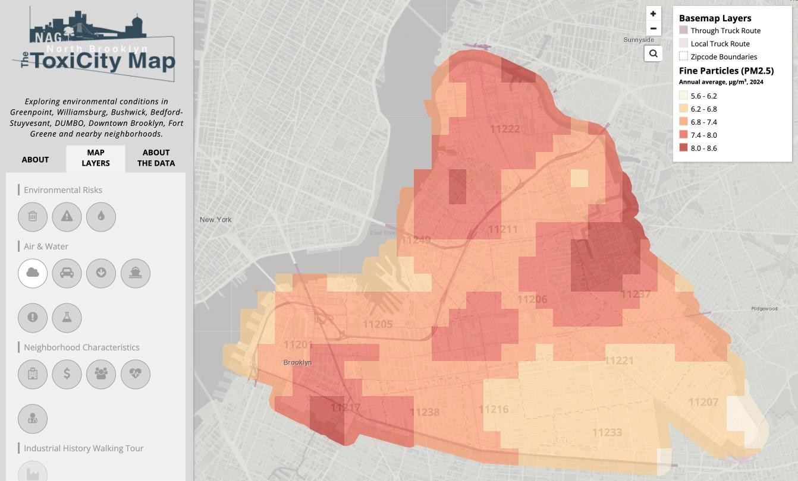

<div align="center">

# North Brooklyn ToxiCity Map

### **Every service this map depended on shut down. The neighborhood's questions didn't.**

[](https://bash102.github.io/nag-toxicology/)
[](https://github.com/bash102/nag-toxicology/actions/workflows/pages.yml)


*An interactive map of pollution, health and demographic data for North Brooklyn, rebuilt on current public data and free, open services.*

[**Open the map**](https://bash102.github.io/nag-toxicology/) · [**What's on it**](#whats-on-the-map) · [**Run locally**](#quick-start) · [**Data sources**](data/SOURCES.md)

</div>

---

## The Problem Everyone Ignores

North Brooklyn lives next to its industrial past: waste transfer stations, truck routes, spill sites, combined sewer outfalls, Newtown Creek, a Superfund site. Residents asking "what's near my block?" have to dig through a dozen agency portals, each with its own format and its own idea of a neighborhood.

In 2015, the Greenpoint-Williamsburg ToxiCity Map answered that question on one page. By 2026 it was a blank screen:

- **The data was gone.** The CARTO account that held every layer no longer existed.
- **The basemap was gone.** Its Mapbox access token had been revoked.
- **Search was gone.** Mapzen, its address search, shut down in 2018.

Nothing in the map was wrong. Everything it stood on had disappeared.

## The Insight That Changed Everything

Civic maps don't die because their data goes stale. They die because they rent their foundations.

<div align="center">

### **Build on open public data and free services**
### **and the map outlives every account it would otherwise need.**

</div>

The rebuild has no API keys and no paid accounts. The data layers live in this repo as GeoJSON, built by scripts from public sources, so anyone can re-run them when the sources update.

<div align="center">

## **If it can't be rebuilt from public data, it isn't really public.**

</div>

## Introducing the North Brooklyn ToxiCity Map

A static site, published by GitHub Pages, covering Brooklyn Community Districts 1 through 4: Greenpoint, Williamsburg, Bushwick, Bedford-Stuyvesant, DUMBO, Downtown Brooklyn, Fort Greene, Brooklyn Heights, Boerum Hill, Clinton Hill and the Navy Yard.

| Component | Role |
|:----------|:-----|
| **[Leaflet](https://leafletjs.com/) 1.9** | The map itself, in place of the retired cartodb.js and mapbox.js |
| **[Esri Light Gray Canvas](https://www.arcgis.com/home/item.html?id=8b3d38c0819547faa83f7b7aca80bd76)** | Basemap tiles, with truck routes, zip codes and the study-area mask redrawn on top from current NYC data |
| **[NYC GeoSearch](https://geosearch.planninglabs.nyc/)** | Free address search from NYC Planning, with no API key |
| **`data/*.geojson`** | Every data layer, versioned in the repo |
| **`scripts/`** | Rebuild every layer from its public source |

## See It In Action

<div align="center">

[](https://bash102.github.io/nag-toxicology/)

*Fine particle pollution (PM2.5), 2024 annual average from the NYC Community Air Survey. [Try it live.](https://bash102.github.io/nag-toxicology/)*

</div>

## What's On the Map

| Theme | Layers | Why It Matters |
|:------|:-------|:---------------|
| **Environmental risks** | Potentially polluted sites (EPA ECHO, NYS DEC spills and remediation, NYC OER cleanups, (E) designations), waste transfer stations, future flood risk (2050s floodplains) | Where contamination, heavy trucking and flooding overlap |
| **Air and water** | Fine particles (PM2.5), nitrogen dioxide (NO2), cancer risk from air toxics, combined sewer overflows, harbor water quality, lead water service lines | What's in the air you breathe and the water around you |
| **Neighborhood characteristics** | Population density, median household income (ACS 2020-2024), asthma emergency visits, cancer cases, adult health conditions (CDC PLACES, with a picker) | Who carries the burden |

Fourteen data layers in all (air quality, sewer overflows, harbor water quality, lead service lines and adult health conditions are new since 2015), plus truck routes and zip codes on the basemap and an address search that zooms to your block. Every source and processing step is documented in [`data/SOURCES.md`](data/SOURCES.md). These are new datasets, so values and site lists differ from the 2015 map.

## Quick Start

The map loads its data with XHR, so serve the folder over HTTP rather than opening `index.html` directly:

```
python3 -m http.server 8000
```

Then visit http://localhost:8000.

## How It Works

```
 public sources (ACS, NYS DOH, EPA ECHO, DEC, NYC OER, CDC PLACES, NYCCAS, ...)
        │  scripts/build_all.py, scripts/build_basemap_overlays.py
        ▼
 data/*.geojson ──► index.html + js/ (Leaflet, styles.js, legendstyles.js) ──► GitHub Pages
                                     ▲
                 Esri basemap tiles ─┘   NYC GeoSearch (address lookup)
```

No server, no database, no build step for the site itself. A push to `main` publishes it.

## The Story Behind the Map

The original map was built in summer and fall 2015 by [Chris Henrick](https://github.com/clhenrick/) and [Bowon Chung](https://github.com/bowon) for [Neighbors Allied for Good Growth](http://nag-brooklyn.org/) and [Pratt](https://www.pratt.edu/)'s [Spatial Analysis and Visualization Initiative](https://www.pratt.edu/pratt-research-and-centers/spatial-analysis-visualization-initiative/). It put the environmental conditions of Greenpoint and Williamsburg onto a single, searchable page.

In 2026 it no longer loaded. The code was fine; the services under it had gone one by one. Rather than let it stay dark, this fork swapped each rented piece for an open one: Leaflet for the map, Esri tiles for the base, NYC's own geocoder for search, and GeoJSON in the repo for the data. Then it rebuilt every layer from current public sources, widened the area to Community Districts 1 through 4, and added what the original never had: air quality, sewer overflows, harbor water quality, lead service lines and adult health conditions.

One thing couldn't come back. The Industrial History Walking Tour was NAG's own content, stored only in the deleted CARTO account. [Its slot is ready](#2026-update) for anyone who still has the stops.

<div align="center">

### Public data deserves a map that can't be switched off.

</div>

---

# Reference

## 2026 Update
This is a fork of [clhenrick/greenpoint_williamsburg_toxicity_map](https://github.com/clhenrick/greenpoint_williamsburg_toxicity_map). By 2026 the original map had stopped working because every hosted service it relied on had shut down:

- **Data layers:** the `nag-brooklyn` CARTO account that held the data no longer exists.
- **Basemap:** the custom Mapbox basemap's access token is revoked.
- **Address search:** Mapzen Search shut down in 2018.

The fork fixes this as follows:

- **Map library:** the map now uses [Leaflet](https://leafletjs.com/) 1.9 directly, in place of cartodb.js and mapbox.js.
- **Basemap:** [Esri's Light Gray Canvas](https://www.arcgis.com/home/item.html?id=8b3d38c0819547faa83f7b7aca80bd76) tiles are the base. The original basemap's truck routes, zip code boundaries and study-area mask are drawn on top, rebuilt from current NYC data (`data/basemap/`).
- **Address search:** it uses [NYC GeoSearch](https://geosearch.planninglabs.nyc/), a free Pelias geocoder from NYC Planning that needs no API key.
- **Data layers:** they are rebuilt from current public data, such as ACS 2020-2024, NYS DOH asthma rates, NYC 2050s floodplains, EPA ECHO, NYC (E) designations, NYS DEC spills and remediation sites, NYC OER cleanup sites and DEC solid waste facilities. The layers are stored as GeoJSON in `data/`. See [`data/SOURCES.md`](data/SOURCES.md) for every source and processing step. These are new datasets, so values and site lists differ from the 2015 map.
- **New layers (2026):** air pollution (NYC Community Air Survey PM2.5 and NO2), combined sewer overflow outfalls, harbor water quality, lead water service lines, and adult health conditions from CDC PLACES with a picker for the condition shown.
- **Walking tour:** the **Industrial History Walking Tour** layer is disabled. Its stops were NAG's own content, stored only in the deleted CARTO account. To restore it, add `data/industrial_history_points.geojson` (points with a numeric `stop` property giving the tour order, plus `name`, `address`, `type_of_industry_present_or_former`, `description`, `source_one` and `source_two`), then remove `disabled` from the `#industry` button in `index.html`.

## Publishing
`.github/workflows/pages.yml` publishes the map to GitHub Pages whenever `main` changes, at https://bash102.github.io/nag-toxicology/. To turn it on the first time, open the repository's **Settings > Pages** and set **Source** to **GitHub Actions**, then re-run the workflow from the **Actions** tab (or push to `main`).

## Dependencies
Loaded from CDNs in `index.html`:

- Leaflet
- jQuery
- jQuery UI
- Font Awesome

Bundled in the repo:

- Handlebars.js (`js/bower_components/`)
- the Pelias Leaflet geocoder (`js/pelias-leaflet-geocoder.js`)
- Normalize.css

## Rebuilding the Data
The scripts in `scripts/` download the public sources and write `data/`. They need Python 3 with `pyshp`, `shapely`, `pyproj`, `rasterio` and `numpy`, plus the `pdftotext` command (poppler-utils) for the sewer overflow report.

```
python3 scripts/build_all.py               # data layers
python3 scripts/build_basemap_overlays.py  # truck routes, zip codes, study area mask
```

## Updating the Data Layers' Styles
Layer styles are in `js/styles.js`, which is a port of the original CartoCSS. Legends are in `js/legendstyles.js`. The health conditions, cancer, air toxics and lead legends are built from the breaks and colors in `js/styles.js`; for the other layers, update both files when you change class breaks or colors.

## Original Data Processing in CartoDB
See the `sql/` directory for the 2015 code that formatted the original data tables in CartoDB / Postgres.

## Creating The Basemap Tiles
The original custom basemap required [Mapbox Studio Classic](https://www.mapbox.com/mapbox-studio-classic/), which has been discontinued. The `basemap/` directory contains:

- `tm2/`: the files specifying the styling of the basemap's tiles.
- `data/`: zipped ESRI Shapefiles used by the original basemap (Greenpoint and Williamsburg only). Not used by the current map.
- `toxicity-basemap.tm2z`: the project's styles and metadata in a compressed format.

## Contributors:
- [Chris Henrick](https://github.com/clhenrick/)
- [Bowon Chung](https://github.com/bowon)


---

<div align="center">

**Know what's next door.**

[Open the map](https://bash102.github.io/nag-toxicology/) · If it's useful to your block or your organizing, [star the repo](https://github.com/bash102/nag-toxicology)

</div>
